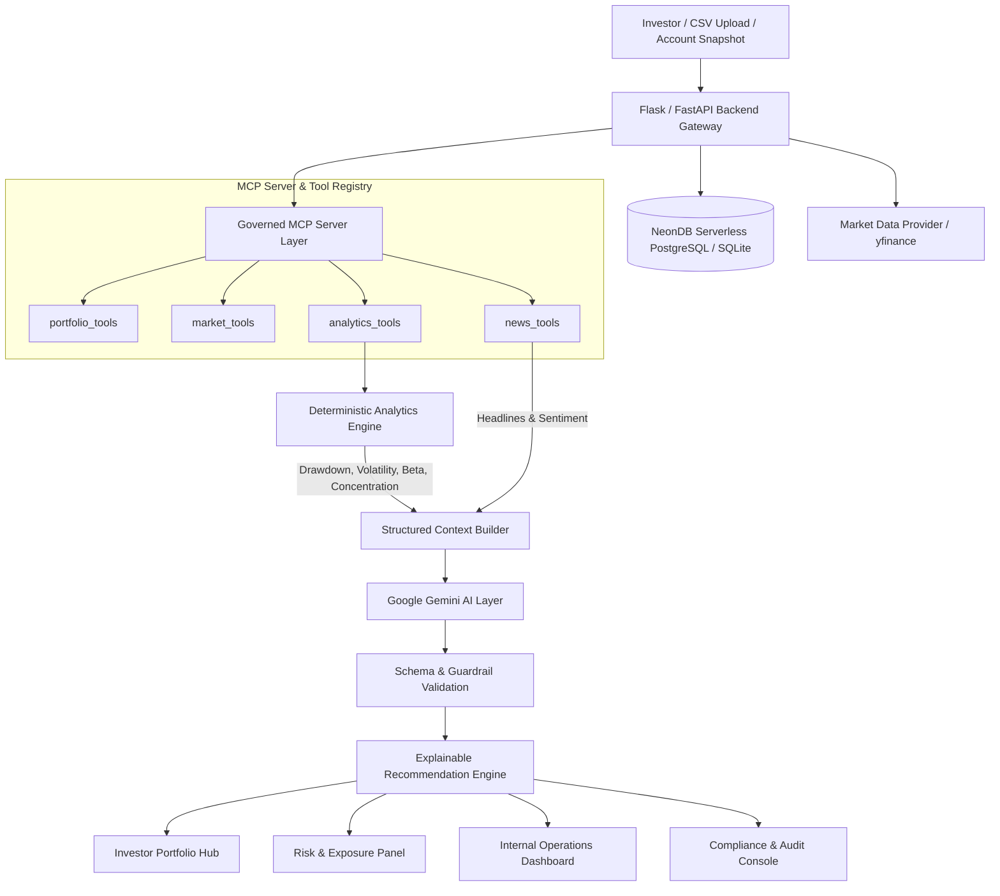
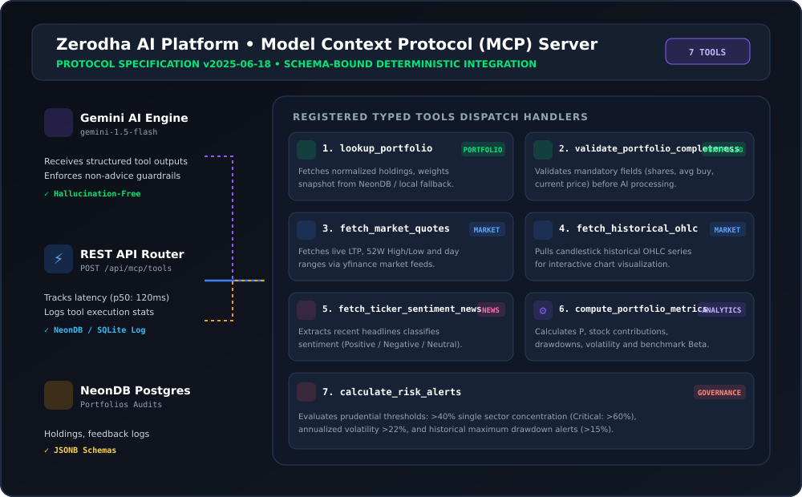

# Zerodha: AI Financial Intelligence Platform

> **Governed Portfolio Intelligence, MCP Unification & Explainable Recommendations Engine**
> 
> *A production-grade, audit-ready AI platform designed to convert raw holdings, live market signals, and news into explainable portfolio insights without uncontrolled trade-execution risk.*

---

## 1. Executive Summary & Problem Framing


### Executive Alignment Matrix

| Requirement Area | Capstone Notion Criteria | Implementation Status in Workspace | Location in Codebase |
|---|---|---|---|
| **Core Architecture & Flow** | Governed deterministic intelligence pipeline: Portfolio Ingestion $\to$ Market/Internal Fetch $\to$ MCP Tools $\to$ Deterministic Analytics $\to$ LLM Reasoning $\to$ Explainable Cards | **Implemented & Verified** | `backend/app.py`<br>`docs/architecture.md` |
| **Model Context Protocol (MCP)** | Standardized, schema-bound MCP server layer uniting tools for data retrieval, risk analytics, and market news | **Implemented (7 Governed Tools)** | `mcp_server/server.py`<br>`mcp_server/tools/`<br>`docs/mcp_tooling.md` |
| **Deterministic Analytics Engine** | Factual calculation of P&L contribution, historical Max Drawdown, Beta, Volatility, and $>40\%$ sector concentration alerts before LLM prompt assembly | **Implemented (Pandas / NumPy)** | `analytics/portfolioAnalytics.py`<br>`analytics/marketData.py` |
| **GenAI Reasoning & Guardrails** | LLM (Google Gemini) generating structured plain-language summaries without hallucinated numbers or unauthorized trade executions | **Implemented & Guardrailed** | `ai_workflows/insightGenerator.py` |
| **Recommendation Engine** | 4 Categorized actionable cards: *Risk Attention*, *Diversification Review*, *Catalyst Monitoring*, *Rebalancing Follow-up* with confidence scores and disclaimers | **Implemented** | `ai_workflows/insightGenerator.py`<br>`frontend/src/components/` |
| **Fullstack User Experience** | 6 complete product surfaces: Stocks & Benchmarks, F&O/IPO, Mutual Funds/ETFs, Portfolio AI Hub, Operations Dashboard, Compliance & Audit Console | **Implemented (React + Vite + Tailwind)** | `frontend/src/` |
| **Compliance & Observability** | SHA-256 prompt hashing, model version traceability, SEBI non-advice disclaimers, latency monitoring (p50/p95), compliance officer sign-offs | **Implemented** | `backend/db.py`<br>`frontend/src/components/ComplianceConsole.jsx` |
| **Database & Ingestion** | Support for Zerodha CSV imports, portfolio snapshots, NeonDB Serverless PostgreSQL + SQLite fallback | **Implemented** | `backend/db.py`<br>`data/portfolio/` |
| **Testing & CI/CD** | Automated test suite covering analytics, MCP tools, AI schema validations, and edge cases | **Implemented** | `tests/test_analytics.py`<br>`tests/test_mcp_server.py`<br>`tests/test_ai_validation.py`<br>`tests/test_edge_cases.py` |
| **Deployment Deliverables** | Containerization, deployment guides, API documentation, and presentation demo script | **Implemented** | `Dockerfile`<br>`docker-compose.yml`<br>`docs/api_documentation.md`<br>`docs/demo_script.md` |

---

## 2. Product Surfaces

The platform delivers 6 cohesive, production-ready product surfaces:

1. **Stocks & Market Benchmark Hub**: Live NIFTY 50, SENSEX, BANKNIFTY indices, interactive OHLC candlestick charts, and top bluechip gainers/losers.
2. **F&O & IPO Intelligence Console**: PCR ratios, Max Pain strikes, open interest buildup interpretation, and grey market premium (GMP) IPO tracking.
3. **Mutual Funds & ETF Analyzer**: Profile-aligned fund suggestions (Flexi-Cap, Mid-Cap, Hybrid, Debt) for balanced capital preservation.
4. **Investor Portfolio AI Hub**:
   - **Relative Performance Card**: Portfolio vs. Benchmark return alpha.
   - **Executive Summary**: Plain-language AI portfolio health overview.
   - **Risk & Exposure Panel**: Sector concentration alerts (>40%), historical maximum drawdown, and portfolio Beta.
   - **Market Movement Explainer**: Stock-level P&L contribution breakdown linked to recent corporate news.
   - **Explainable Recommendation Console**: 4 categorized recommendation cards (*Risk Attention, Diversification Review, Catalyst Monitoring, Rebalancing Follow-up*) with confidence scores, rationales, and regulatory disclaimers.
5. **Internal Operations & Health Dashboard**: Live monitoring for API latency (p50/p95), error rates, uptime, MCP tool distribution, feedback mix, and interactive MCP tool testing.
6. **Compliance & Regulatory Audit Console**: Cryptographic SHA-256 prompt hashing, model version traceability, SEBI non-advice verification, and formal compliance officer sign-offs.

---

## 3. System Architecture & Tech Stack



### Technology Matrix

| Component | Technology | Role & Purpose |
|---|---|---|
| **Frontend** | React 18 (Vite), Tailwind CSS, Lucide Icons | Responsive investor hub, charts, operations and compliance consoles |
| **Backend API** | Python (Flask / Flask-CORS / Flask-JWT) | REST API routing, JWT auth, database connectors, and audit trail |
| **MCP Integration** | Model Context Protocol (v2025-06-18) | Schema-bound tool access for portfolio, market, news, and risk analytics |
| **Analytics Engine** | Python (Pandas, NumPy) | Deterministic calculation of P&L, concentration, drawdown, volatility, beta |
| **LLM Reasoning** | Google Gemini 1.5/3.5 Flash (`@google/genai`) | Structured plain-language explanations and recommendation generation |
| **Database** | NeonDB PostgreSQL / SQLite Hybrid | User accounts, portfolio holdings JSONB, compliance logs, MCP execution stats |
| **Deployment** | Vercel (Frontend) & Render / Railway (Backend) | Cloud deployment with environment variable isolation |

---

## 4. Model Context Protocol (MCP) Server

The platform includes a dedicated, schema-bound **Model Context Protocol (MCP)** Server implementation (`mcp_server/`) conforming to protocol specification `v2025-06-18`.



### Governed Tool Registry

| Tool Name | Category | Primary Function | Return Output / Telemetry |
|---|---|---|---|
| **`lookup_portfolio`** | `portfolio` | Fetches normalized holdings snapshot, allocation weights & risk profile | NeonDB PostgreSQL JSONB / Local JSON fallback |
| **`validate_portfolio_completeness`** | `portfolio` | Pre-inference gate verifying required fields (shares, avg buy, current price) | Completeness score (0-100%) & validation report |
| **`fetch_market_quotes`** | `market` | Real-time LTP, % change, 52W High/Low and day ranges | Live `yfinance` fast-info quotes with cache fallback |
| **`fetch_historical_ohlc`** | `market` | Historical daily Open-High-Low-Close candle series & volume | Interactive candlestick chart time-series payload |
| **`fetch_ticker_sentiment_news`** | `news` | Symbol-specific news headlines with automated sentiment tagging | Recent headlines with POSITIVE/NEGATIVE/NEUTRAL tags |
| **`compute_portfolio_metrics`** | `analytics` | Deterministic mathematical calculation of P&L, contribution, beta, drawdown | Grounded factual analytics payload for LLM reasoning |
| **`calculate_risk_alerts`** | `analytics` | Prudential threshold rules (>40% sector concentration, >22% volatility) | Governed risk warnings and critical alert levels |

---

## 5. How to Run the Platform

You can run the entire platform either using **Docker (Recommended)** for single-command fullstack setup or via **Local Development Mode**.

---

### Method 1: Run with Docker (Recommended)

The platform includes a production multi-stage [`Dockerfile`](file:///e:/zerodha-ai-financial-intelligence-platform/Dockerfile) (Node.js 20 build stage + Python 3.11 runtime stage) and a [`docker-compose.yml`](file:///e:/zerodha-ai-financial-intelligence-platform/docker-compose.yml).

#### Option A: Using Docker Compose (Simplest)

1. Ensure your `.env` file is present in the project root:
   ```bash
   # Verify .env exists and contains GEMINI_API_KEY and NEON_DATABASE_URL
   ```

2. Build and start the unified fullstack container:
   ```bash
   docker compose up --build
   ```

3. Open your browser and navigate to:
   - **Fullstack Web Application**: [http://localhost:5000](http://localhost:5000)
   - **Operations Health Endpoint**: [http://localhost:5000/api/operations/health](http://localhost:5000/api/operations/health)

4. To stop the container:
   ```bash
   docker compose down
   ```

#### Option B: Using Docker CLI Directly

1. Build the unified Docker image:
   ```bash
   docker build -t zerodha-ai-platform .
   ```

2. Run the container with your `.env` file:
   ```bash
   docker run -d -p 5000:5000 --name zerodha-ai --env-file .env zerodha-ai-platform
   ```

3. View live container logs:
   ```bash
   docker logs -f zerodha-ai
   ```

4. Stop and remove the container:
   ```bash
   docker stop zerodha-ai && docker rm zerodha-ai
   ```

---

### Method 2: Local Development Mode (Without Docker)

#### Prerequisites
- **Python 3.10+**
- **Node.js 18+** & **npm**

#### Step 1: Backend Setup
```bash
# 1. Open a terminal in the project root directory
cd zerodha-ai-financial-intelligence-platform

# 2. (Optional) Create and activate a Python virtual environment
python -m venv venv
# On Windows:
.\venv\Scripts\activate
# On Linux/macOS:
# source venv/bin/activate

# 3. Install Python backend & analytics dependencies
pip install -r backend/requirements.txt

# 4. Start the Flask API & Governed MCP Backend Server
python backend/app.py
```
> The Backend API server will start at: **http://localhost:5000**

#### Step 2: Frontend Setup
```bash
# 1. Open a second terminal window and navigate to the frontend directory
cd frontend

# 2. Install Node.js dependencies
npm install

# 3. Start the Vite React development server
npm run dev
```
> The Frontend Single Page Application will start at: **http://localhost:5173** (with automated API reverse proxy to backend port 5000).

---

## 6. Automated Test Suite

Run the full automated test suite covering analytics math, MCP server protocols, AI structured output schemas, and boundary edge cases:

```bash
# Run all unit and integration tests
python -m unittest discover tests

# Or run specific test suites individually:
python -m unittest tests/test_analytics.py       # P&L, Beta, Drawdown & Concentration math
python -m unittest tests/test_mcp_server.py       # MCP Tool registry & execution schemas
python -m unittest tests/test_ai_validation.py    # Structured JSON schemas & card guards
python -m unittest tests/test_edge_cases.py       # Missing fields, zero balance & volatility spikes
```

---

## 7. Submission Deliverables Checklist

- [x] **Complete GitHub Repository** with clear modular folder structure (`frontend/`, `backend/`, `mcp_server/`, `ai_workflows/`, `analytics/`, `docs/`, `tests/`, `deployment/`).
- [x] **Environment Configuration** (`.env`) with complete configuration parameters.
- [x] **Governed MCP Server** with schema-bound tool registry and live execution console.
- [x] **Deterministic Analytics Engine** calculating P&L contribution, concentration alerts, max drawdown, volatility, and benchmark Beta.
- [x] **AI Workflow & Explainable Recommendations** with 4 distinct card categories and strict non-execution guardrails.
- [x] **Internal Operations Dashboard** monitoring uptime, latency, MCP tool telemetry, and feedback.
- [x] **Compliance & Regulatory Audit Console** with prompt hashes, model versions, and reviewer sign-offs.
- [x] **Documentation & Video Suite** (`docs/architecture.md`, `docs/api_documentation.md`, `docs/mcp_tooling.md`, `docs/demo_script.md`, `docs/video/video.mp4`).
- [x] **Live Video Walkthrough Demo** (Embedded in README + Google Drive link).
- [x] **Production Cloud Deployment** ([Live on Render](https://zerodha-ai-financial-intelligence-welg.onrender.com/)).
- [x] **Automated Test Suite** (`tests/`) with unit and edge-case coverage.

---

## 8. Team & Contribution Ownership

| Role | Lead | Responsibilities |
|---|---|---|
| **Product & Business Architecture** | Mubarra Shaikh | Dossier alignment, SEBI regulatory non-advice framing, UX workflows |
| **AI Workflows & MCP Server** | Mubarra Shaikh | Gemini prompt engineering, MCP tool schemas, structured output validation |
| **Backend & Ingestion APIs** | Mubarra Shaikh | Flask REST APIs, JWT authentication, NeonDB/SQLite persistence, audit trail |
| **Frontend & UI Surfaces** | Mubarra Shaikh | Multi-tab React app, recommendation cards, operations and compliance consoles |
| **QA & Analytics Testing** | Mubarra Shaikh | Deterministic metrics formulas, test suites, edge case validation |