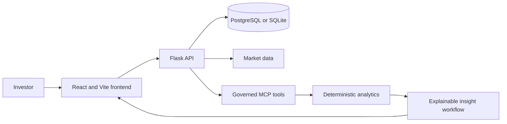

# Zerodha AI Financial Intelligence Platform

An AI-assisted portfolio intelligence application that combines deterministic
portfolio analytics, market data, and explainable AI insights. The platform is
designed to help investors understand portfolio performance and risk; it does
not execute trades.

## Live Demo

[](https://zerodha-ai-financial-intelligence-welg.onrender.com/)

Click the workflow image to watch the walkthrough on Google Drive:

[](https://drive.google.com/file/d/1VoxiG_ixopPTqTrXDg_Vc5u6X_9xqfun/view?usp=sharing)

[Watch the video on Google Drive](https://drive.google.com/file/d/1VoxiG_ixopPTqTrXDg_Vc5u6X_9xqfun/view?usp=sharing) · [Open the video in this repository](docs/video/zerodhaAI.mp4)

## 1. What the Platform Does

- **Portfolio analysis:** Summarizes holdings, P&L contributions, allocations,
  sector concentration, volatility, drawdown, and benchmark-relative performance.
- **Market intelligence:** Presents market quotes and related market context.
- **Explainable AI insights:** Generates a portfolio summary, risk analysis, and
  recommendations with rationales and confidence scores. AI insights are
  supplementary and do not replace deterministic calculations.
- **Governed MCP tools:** Exposes portfolio, market, and analytics capabilities
  through a schema-defined tool registry.
- **Operations and compliance:** Provides health and operational telemetry,
  feedback/audit records, prompt hashes, model-version information, and review
  workflows.
- **Portfolio import:** Supports importing holdings from a CSV file.

This is an informational application, not investment advice. It does not place,
route, or execute trades.

## 2. Architecture



The Docker image builds the frontend and serves it from the Flask/Gunicorn
backend. In production, the UI and API can therefore use the same service and
domain.

## 3. Technology

- **Frontend:** React, Vite, Tailwind CSS, and Lucide icons
- **Backend:** Python, Flask, Flask-CORS, Flask-JWT-Extended, and Gunicorn
- **Analytics:** Pandas and NumPy
- **Database:** PostgreSQL when `DATABASE_URL` or `NEON_DATABASE_URL` is set;
  SQLite is available as a local fallback
- **AI:** Google Gemini through the Google Gen AI SDK (optional API key)
- **Deployment:** Docker; Railway and Render deployment configuration/documentation

## 4. Run Locally

### Prerequisites

- Python 3.11 or newer
- Node.js 20 or newer and npm

### Configure the backend

From the repository root, create a virtual environment and install the backend
dependencies:

```powershell
py -3.11 -m venv .venv
.\.venv\Scripts\Activate.ps1
python -m pip install -r backend/requirements.txt
Copy-Item .env.example .env
```

On macOS or Linux, use:

```bash
python3 -m venv .venv
source .venv/bin/activate
python -m pip install -r backend/requirements.txt
cp .env.example .env
```

Edit `.env` as needed. `GEMINI_API_KEY` enables Gemini-powered insights. For
persistent local data across restarts, configure a PostgreSQL URL in
`DATABASE_URL` or `NEON_DATABASE_URL`; otherwise the app uses SQLite.

### Start the app

Open two terminals at the repository root.

**Terminal 1 — API:**

```bash
python backend/app.py
```

The API runs at `http://localhost:5000`.

**Terminal 2 — frontend:**

```bash
cd frontend
npm ci
npm run dev
```

Open the local URL printed by Vite (typically `http://localhost:5173`). The Vite
development server proxies `/api` requests to the Flask backend.

## 5. Configuration

Use `.env.example` as a template for a local `.env` file. Never commit real
credentials or production secrets.

| Variable | Purpose |
| --- | --- |
| `GEMINI_API_KEY` | Optional Google AI Studio key for AI-generated insights |
| `DATABASE_URL` | PostgreSQL connection URL, including Railway's standard variable |
| `NEON_DATABASE_URL` | Alternate PostgreSQL connection URL |
| `JWT_SECRET_KEY` | Secret used to sign authentication tokens; set a strong, unique value in production |
| `PORT` | HTTP port; Railway supplies this automatically |
| `HOST` | Local Flask bind address |
| `FLASK_DEBUG` | Enables Flask debug mode for local development only |
| `VITE_API_URL`, `VITE_API_BASE_URL` | Optional frontend API URL overrides; leave unset for same-domain deployments |

## 6. Deploy

### Railway

The repository root contains `railway.json` and a Dockerfile for a single
frontend-plus-backend service.

1. Push the repository to GitHub.
2. In Railway, create a project and deploy the GitHub repository. Keep the
   service root directory at the repository root.
3. Add a Railway PostgreSQL service. In the app service, set `DATABASE_URL` to
   the PostgreSQL service's connection-string reference (for example,
   `${{Postgres.DATABASE_URL}}`, using the actual service name).
4. Set `JWT_SECRET_KEY` to a strong, unique secret. Set `GEMINI_API_KEY` if you
   want Gemini-powered insights.
5. Deploy and wait for the `/api/operations/health` health check to pass.
6. Generate a public domain in the app service's Networking settings if Railway
   has not already created one.

The built-in frontend and API share the Railway domain; do not set
`VITE_API_URL` for this setup. PostgreSQL is recommended for persistent
production data. SQLite fallback data is ephemeral unless a Railway volume is
mounted at `/app/data`.

### Docker

Build and run the combined app from the repository root:

```bash
docker build -t zerodha-ai-platform .
docker run --env-file .env -p 5000:5000 zerodha-ai-platform
```

Open `http://localhost:5000`. Set `PORT` in the container environment when
running on a platform that assigns a port automatically.

### Render

Create a Render Web Service connected to the repository, select the Docker
runtime, and use the root `Dockerfile`. Configure `JWT_SECRET_KEY`, and add
`GEMINI_API_KEY` and a PostgreSQL `DATABASE_URL` if those services are used.

## Tests

The tests use Python's built-in `unittest` runner:

```bash
python -m unittest discover -s tests -v
python -m unittest discover -s backend -p "test_all_features.py" -v
```

Build the production frontend with:

```bash
cd frontend
npm ci
npm run build
```

## Project Structure

```text
.
├── ai_workflows/    # AI insight generation and guardrails
├── analytics/       # Portfolio and market analytics
├── backend/         # Flask API, database setup, and backend tests
├── data/            # Sample portfolios and local development data
├── deployment/      # Hosting and deployment guidance
├── docs/            # Diagrams, walkthrough video, and project documentation
├── frontend/        # React/Vite application
├── mcp_server/      # MCP server, registry, and tool implementations
├── tests/           # Analytics, AI validation, MCP, and edge-case tests
├── Dockerfile
└── railway.json
```

## 7. Submission Deliverables Checklist

- **Complete GitHub Repository** with clear modular folder structure (`frontend/`, `backend/`, `mcp_server/`, `ai_workflows/`, `analytics/`, `docs/`, `tests/`, `deployment/`).
- **Environment Configuration** (`.env`) with complete configuration parameters. Use `.env.example` as the template and keep secrets out of version control.
- **Governed MCP Server** with schema-bound tool registry and live execution console.
- **Deterministic Analytics Engine** calculating P&L contribution, concentration alerts, max drawdown, volatility, and benchmark Beta.
- **AI Workflow & Explainable Recommendations** with 4 distinct card categories and strict non-execution guardrails.
- **Internal Operations Dashboard** monitoring uptime, latency, MCP tool telemetry, and feedback.
- **Compliance & Regulatory Audit Console** with prompt hashes, model versions, and reviewer sign-offs.
- **Documentation & Video Suite** (`docs/architecture.md`, `docs/api_documentation.md`, `docs/mcp_tooling.md`, `docs/demo_script.md`, `docs/video/video.mp4`).
- **Live Video Walkthrough Demo** (linked above in the README + [Google Drive link](https://drive.google.com/file/d/1VoxiG_ixopPTqTrXDg_Vc5u6X_9xqfun/view?usp=sharing)).
- **Production Cloud Deployment** ([Live on Render](https://zerodha-ai-financial-intelligence-welg.onrender.com/)).
- **Automated Test Suite** (`tests/`) with unit and edge-case coverage.